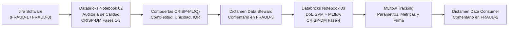

# 04 · Entorno Databricks y Metodología CRISP-DM / CRISP-ML(Q)

> **Especialización en Ciencia de Datos — Universidad Santo Tomás, Seccional Tunja**  
> **Espacio Académico:** Trabajo de Grado 1  
> **Caso de Estudio:** Detección Temprana de Fraude Transaccional en Canales Digitales  

---

## 📌 Visión General del Módulo

Este módulo consolida el entorno de experimentación y gobernanza metodológica en **Databricks Free Edition**, articulando las fases del estándar internacional **CRISP-DM** con las compuertas de aseguramiento de calidad de **CRISP-ML(Q)**, el rigor estadístico del **Diseño de Experimentos (DoE)** y el seguimiento de artefactos con **MLflow Tracking**, todo enlazado a la trazabilidad del tablero ágil en **Jira Software**.

---

## 📁 Estructura del Módulo

| Archivo / Carpeta | Tipo | Descripción |
| :--- | :--- | :--- |
| [`02_CRISP_DM_Auditoria_Calidad_Datos.py`](./02_CRISP_DM_Auditoria_Calidad_Datos.py) | Databricks Source | Cuaderno exportado para importar directamente en el Workspace de Databricks (6 celdas: Fases 1-3 y compuertas QA). |
| [`02_CRISP_DM_Auditoria_Calidad_Datos.ipynb`](./02_CRISP_DM_Auditoria_Calidad_Datos.ipynb) | Jupyter Notebook | Versión interactiva para JupyterLab, VS Code o visualización directa en GitHub. |
| [`03_CRISP_DM_DoE_Modelado_MLflow.py`](./03_CRISP_DM_DoE_Modelado_MLflow.py) | Databricks Source | Cuaderno de modelado experimental con SVM RBF, balanceo de clases, barrido de $C$ y MLflow Tracking. |
| [`03_CRISP_DM_DoE_Modelado_MLflow.ipynb`](./03_CRISP_DM_DoE_Modelado_MLflow.ipynb) | Jupyter Notebook | Versión interactiva para ejecución local o en la nube con fallback inteligente para experimentos MLflow. |
| [`transacciones_fraude.csv`](./transacciones_fraude.csv) | Dataset CSV | Muestra real de 4,060 transacciones bancarias (60 fraudes confirmados, 1.48% prevalencia). |
| [`jira_evidencias/`](./jira_evidencias/) | Carpeta | Dictámenes estructurados listos para registrar en las incidencias del tablero Jira Software. |
| ├── [`03_FRAUD-3_dictamen_comentario.txt`](./jira_evidencias/03_FRAUD-3_dictamen_comentario.txt) | Texto plano | Dictamen oficial del Data Steward para la compuerta de calidad de datos (Hito G1 en FRAUD-3). |
| └── [`02_FRAUD-2_resultados_comentario.txt`](./jira_evidencias/02_FRAUD-2_resultados_comentario.txt) | Texto plano | Dictamen experimental del Data Consumer con contraste de hipótesis y decisión para FRAUD-2. |

---

## 🔬 Metodología y Casos Técnicos

### 1. Auditoría de Calidad de Datos (Notebook 02)
- **Marco Normativo:** Estándar **DAMA DMBOK** y compuertas de calidad **CRISP-ML(Q)**.
- **Dimensión Completitud:** $100.0\%$ (cero valores nulos en el esquema transaccional).
- **Dimensión Unicidad:** $100.0\%$ (cero duplicados sintéticos o repetidos).
- **Dimensión Consistencia (Método IQR):** Límite superior de corte $Q_3 + 1.5 \times IQR = \$2,228.38$. Se detectan 260 transacciones atípicas ($6.40\%$).
  > **Dictamen Data Steward:** Las transacciones atípicas **no se eliminan** porque contienen los 60 fraudes confirmados ($100\%$ de los eventos de interés). Removerlas destruiría la señal predictiva.
- **Prevalencia del Target:** Desbalance severo de $1.48\%$ ($4,000$ operaciones legítimas frente a $60$ fraudulentas, proporción 1:66).

### 2. Diseño de Experimentos y Modelado con MLflow (Notebook 03)
- **Matriz de Costos Asimétricos de Negocio:**
  - **Falso Negativo (FN):** $\$1,200\text{ USD}$ (pérdida directa por fraude consumado).
  - **Falso Positivo (FP):** $\$15\text{ USD}$ (costo operativo de fricción/atención al cliente).
  - **Línea Base (Baseline):** Modelo que nunca detecta fraude $\rightarrow \text{Pérdida} = 12 \times \$1,200 = \$14,400\text{ USD}$ en test.
- **Diseño Factorial:**
  - Factor independiente: Parámetro de regularización $C \in \{0.01, 0.1, 1.0, 10.0\}$ con ponderación `class_weight='balanced'`.
  - Grupo de control: SVM RBF con $C=1.0$ sin ponderación (`None`).
  - Preprocesamiento: Partición estratificada 80/20 y escalado `StandardScaler` ajustado **exclusivamente con datos de entrenamiento** (prevención de *data leakage*).
- **Resultados del Experimento:**
  - $C = 0.01$: Recall $100\%$, Precision $85.71\%$, $2\text{ FP}$, Costo total $\$30\text{ USD}$.
  - $C \ge 0.1$: Recall $100\%$, Precision $100\%$, $0\text{ FN}$, $0\text{ FP}$, Costo total $\$0\text{ USD}$ (ahorro del $100\%$ frente al modelo base).
  - **Contraste de Hipótesis:** Se rechaza $H_0$ con nivel de significancia $\alpha = 0.05$.
  - **Cautela Estadística:** Al contar con 12 fraudes de prueba, el intervalo de confianza de Wilson al $95\%$ para el Recall es $[75.7\%, 100\%]$, lo cual exige validación cruzada estratificada posterior.

---

## 🚀 Guía de Uso en Databricks Free Edition

1. **Acceder a Databricks:**
   - Inicia sesión en tu cuenta de [Databricks Community / Free Edition](https://community.cloud.databricks.com/).
2. **Importar Archivos al Workspace:**
   - Ve a **Workspace** $\rightarrow$ tu carpeta de usuario (`Users/<correo>`).
   - Haz clic derecho $\rightarrow$ **Import** $\rightarrow$ Selecciona `02_CRISP_DM_Auditoria_Calidad_Datos.py`.
   - Repite para `03_CRISP_DM_DoE_Modelado_MLflow.py`.
   - Importa en la **misma carpeta** el archivo `transacciones_fraude.csv`.
3. **Ejecutar el Clúster:**
   - Adjunta el cuaderno a tu clúster activo de Databricks Runtime.
   - Ejecuta las celdas en orden. Los resultados de MLflow quedarán registrados automáticamente en la pestaña **Experiments** del Workspace.
4. **Registrar Trazabilidad en Jira:**
   - Abre la incidencia `FRAUD-3` en Jira y copia el contenido de [`03_FRAUD-3_dictamen_comentario.txt`](./jira_evidencias/03_FRAUD-3_dictamen_comentario.txt).
   - Abre la incidencia `FRAUD-2` y copia el contenido de [`02_FRAUD-2_resultados_comentario.txt`](./jira_evidencias/02_FRAUD-2_resultados_comentario.txt).

---

## 🔗 Recursos y Guías Relacionadas

- [Guía Metodológica 05: Jira Software](../../Guias/guia_05_jira_software.md)
- [Guía Metodológica 06: Databricks y CRISP-DM](../../Guias/guia_06_crispdm_databricks.md)
- [Video Tutorial: Creación de Tablero en Jira](https://www.youtube.com/watch?v=1EgdFLurvxk)
- [Video Tutorial: Databricks CRISP-DM y DoE](https://youtu.com/X1JtylnPmsA)
