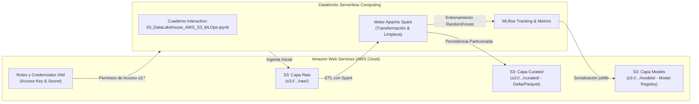

# Guía Práctica: Databricks en Amazon Web Services (AWS) ☁️
## Arquitectura Data Lakehouse con Amazon S3 y MLOps Serverless

> **Especialización en Ciencia de Datos**  
> **Universidad Santo Tomás — Seccional Tunja**  
> **Asignatura:** Trabajo de Grado 1  
> **Autor:** Ing. Santiago Alejandro Zúñiga Melo  
> **Video Tutorial Oficial:** [Ver en YouTube (Databricks en AWS)](https://youtu.be/bnK78l0DeZc)  
> **Documento Oficial PDF:** [`guia_databricks_aws.pdf`](./guia_databricks_aws.pdf) (6.3 MB)

---

## 🧭 1. Resumen Ejecutivo y Arquitectura

Esta guía documenta el procedimiento paso a paso para desplegar y operar una arquitectura analítica moderna de **Data Lakehouse** sobre la nube de **Amazon Web Services (AWS)** integrada con **Databricks Serverless**.

### Diagrama Arquitectónico de la Solución


---

## 🛠️ 2. Creación y Configuración de la Cuenta de AWS

1. **Registro Inicial:**
   * Ingrese a [aws.amazon.com](https://aws.amazon.com/) y seleccione **Crear una cuenta de AWS**.
   * Ingrese su correo institucional o personal y asigne un nombre representativo a la cuenta (e.g., `usta-datascience-lakehouse`).
   * Complete la verificación por código SMS y establezca una contraseña segura.

2. **Configuración de Facturación y Presupuesto Seguro:**
   * En la consola de AWS, busque el servicio **Billing and Cost Management (Facturación)**.
   * Cree un **Presupuesto de Costos Cero / Alerta de Presupuesto (AWS Budgets)** para recibir notificaciones por correo ante cualquier consumo imprevisto.

---

## 🪣 3. Configuración del Data Lakehouse en Amazon S3

1. **Creación del Bucket de Almacenamiento:**
   * En la barra de búsqueda de AWS, navegue al servicio **Amazon S3**.
   * Haga clic en **Crear bucket**.
   * Asigne un nombre globalmente único con nomenclatura estándar:  
     `lakehouse-california-housing-[tu-nombre]` (e.g., `lakehouse-california-housing-santiago`).
   * **Región:** Seleccione `us-east-1` (Norte de Virginia) o `us-east-2` (Ohio).
   * Active el **Control de versiones de buckets** (*Bucket Versioning*) para trazabilidad de datasets.
   * Mantenga activada la opción **Bloquear todo el acceso público** (*Block all public access*) para máxima seguridad.

2. **Estructura de Capas del Lakehouse:**
   Dentro del bucket creado, cree las siguientes carpetas (*prefixes*):
   * `raw/`: Almacenamiento inmutable del dataset original en CSV / JSON crudo.
   * `curated/`: Datos limpios, tipados y particionados en formato columnar **Parquet / Delta Lake**.
   * `models/`: Artefactos de modelos de Machine Learning exportados en `.joblib` o MLflow format.

---

## 🔐 4. Gestión de Identidad y Accesos (IAM)

1. En la consola de AWS, ingrese a **IAM (Identity and Access Management)**.
2. Navegue a **Usuarios (Users)** y cree un usuario técnico específico: `databricks-lakehouse-user`.
3. Asigne la política de permisos administrada **`AmazonS3FullAccess`** (o una política personalizada con restricción al bucket creado).
4. En la pestaña **Credenciales de seguridad (Security credentials)**, genere un par de claves:
   * **Access Key ID:** `AKIA...`
   * **Secret Access Key:** `wJalrXUtn...`
   > ⚠️ **Importante:** Guarde el archivo `.csv` descargado en un lugar seguro. Nunca comparta ni suba estas credenciales a repositorios públicos de GitHub.

---

## 🧱 5. Conexión de Databricks con Amazon S3

1. **Acceso al Workspace:**
   * Inicie sesión en su espacio de trabajo de **Databricks** (Community Edition o Databricks AWS).
2. **Importación del Cuaderno:**
   * Vaya a **Workspace** → Seleccione su carpeta de usuario.
   * Haga clic en **Import** y cargue [`03_DataLakehouse_AWS_S3_MLOps.ipynb`](../02%20-%20AWS%20Databricks%20y%20Lakehouse%20S3/03_DataLakehouse_AWS_S3_MLOps.ipynb).

3. **Inyección de Credenciales y Validación de Conexión:**
   En las primeras celdas del cuaderno interactivo, configure las variables de entorno de AWS:

```python
import os
import boto3

# Inyección segura de credenciales
os.environ["AWS_ACCESS_KEY_ID"] = "TU_ACCESS_KEY_AQUI"
os.environ["AWS_SECRET_ACCESS_KEY"] = "TU_SECRET_KEY_AQUI"
os.environ["AWS_DEFAULT_REGION"] = "us-east-1"

BUCKET_NAME = "lakehouse-california-housing-santiago"

# Validación de conexión con S3
s3_client = boto3.client("s3")
response = s3_client.list_buckets()
print("✅ Conexión exitosa. Buckets disponibles:", [b['Name'] for b in response['Buckets']])
```

---

## 🧪 6. Ingesta, Procesamiento y Experimento MLOps

1. **Ingesta en Capa Raw:**
   * Carga del conjunto de datos **California Housing** desde `sklearn.datasets`.
   * Exportación local a CSV y subida directa al bucket mediante `boto3`:  
     `s3://lakehouse-california-housing-.../raw/california_housing.csv`

2. **Procesamiento y Curación (Capa Curated):**
   * Limpieza de valores nulos o atípicos, tipificación estricta de columnas.
   * Conversión y persistencia en formato optimizado **Apache Parquet**:  
     `s3://lakehouse-california-housing-.../curated/california_housing.parquet`

3. **Diseño Experimental Científico (MLOps con MLflow):**
   * **Hipótesis:** *"Aumentar el número de estimadores (`n_estimators`) en un ensamble Random Forest reduce el error cuadrático medio (RMSE) en la predicción del valor de vivienda con rendimientos decrecientes y convergencia asintótica a partir de 150 árboles."*
   * **Tracking con MLflow:**
     ```python
     import mlflow
     import mlflow.sklearn
     from sklearn.ensemble import RandomForestRegressor
     from sklearn.metrics import mean_squared_error, r2_score

     mlflow.set_experiment("/Users/tu_usuario/california_housing_experiment")

     for n_trees in [10, 25, 50, 100, 150, 200]:
         with mlflow.start_run(run_name=f"rf_trees_{n_trees}"):
             model = RandomForestRegressor(n_estimators=n_trees, random_state=42)
             model.fit(X_train, y_train)
             preds = model.predict(X_test)
             rmse = mean_squared_error(y_test, preds, squared=False)
             r2 = r2_score(y_test, preds)

             # Registro de parámetros y métricas
             mlflow.log_param("n_estimators", n_trees)
             mlflow.log_metric("rmse", rmse)
             mlflow.log_metric("r2", r2)
     ```

4. **Persistencia del Modelo Óptimo (Capa Models):**
   * Serialización del modelo con `joblib.dump()`.
   * Subida del binario a `s3://.../models/random_forest_best.joblib`.
   * Validación de consistencia transaccional y disponibilidad para inferencia.

---

## 📌 7. Buenas Prácticas y Cierre del Entorno

1. **Control de Costos:** Al finalizar la sesión, desactive los recursos de cómputo en ejecución y asegúrese de que el bucket S3 contenga únicamente los datos esenciales para no exceder la capa gratuita.
2. **Seguridad:** En caso de compartir el código o cuaderno, elimine las claves de acceso de AWS del historial de ejecución y revoque las credenciales en la consola de IAM si sospecha exposición.

