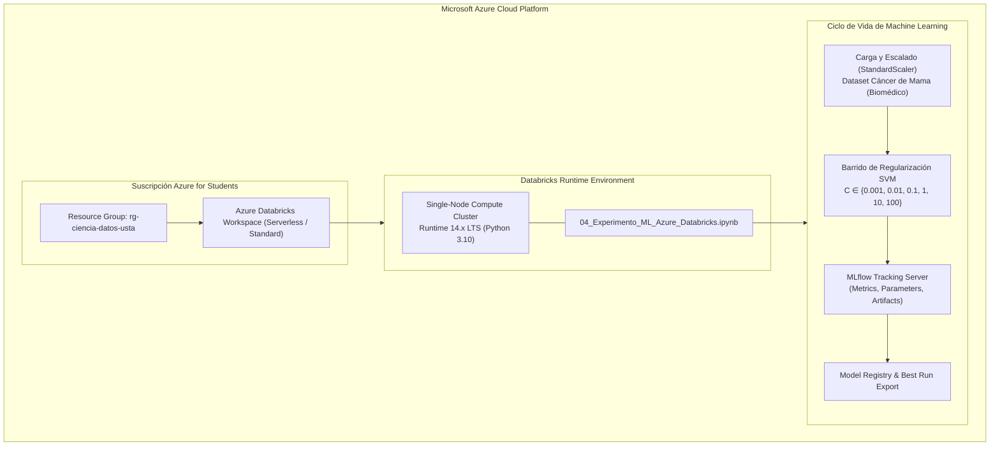
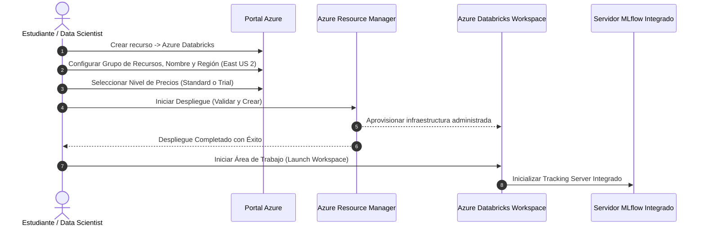
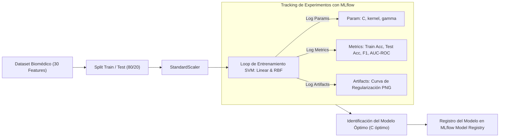

# Guía de Laboratorio: Aprovisionamiento de Azure Databricks y Experimento de Regularización SVM con MLflow

Esta guía técnica complementa el video tutorial oficial **[Azure Databricks](https://youtu.be/OBnE-UgaoUU)** y el documento oficial en PDF [`guia_azure_databricks.pdf`](./guia_azure_databricks.pdf), detallando el aprovisionamiento de un Workspace en Azure Cloud, configuración de clusters y ejecución del pipeline MLOps con seguimiento de experimentos en MLflow.

---

## 🏗️ 1. Arquitectura de la Solución en Azure Cloud

---

## 📋 2. Requisitos Previos y Activación de Suscripción

1. **Cuenta Institucional USTA Tunja:**
   - Acceso al portal de estudiantes: `azure.microsoft.com/free/students`.
   - Autenticación federada de Microsoft con el correo institucional.
   - Completar la verificación académica para obtener el crédito de estudiante sin tarjeta de crédito.

2. **Acceso al Portal de Azure:**
   - Iniciar sesión en `portal.azure.com`.
   - Validar en **Suscripciones** que el estado sea *Activo* con los créditos asignados.

---

## ⚙️ 3. Aprovisionamiento del Workspace de Azure Databricks

### Pasos de Configuración en el Asistente:
- **Suscripción:** Azure for Students
- **Grupo de recursos:** Crear nuevo (ej. `rg-databricks-mlops`)
- **Nombre del área de trabajo:** `dbw-usta-ciencia-datos`
- **Región:** `East US 2` (o la más cercana con cuota disponible)
- **Nivel de precios:** `Standard` (con soporte para Serverless y clusters Single-Node)

---

## 💻 4. Importación y Ejecución del Cuaderno de Machine Learning

1. **Importación del Cuaderno:**
   - En la barra lateral izquierda de Azure Databricks, seleccionar **Workspace** > **Users** > `[Tu Correo]`.
   - Hacer clic derecho o en el menú desplegable y seleccionar **Import**.
   - Subir el archivo `04_Experimento_ML_Azure_Databricks.ipynb`.

2. **Asignación de Cómputo:**
   - Crear o adjuntar un cluster Single-Node con Databricks Runtime compatible con ML.
   - Alternativamente, seleccionar cómputo Serverless si está habilitado en la suscripción.

---

## 🔬 5. Pipeline Experimental: Regularización SVM y Tracking MLflow

### Aspectos Clave del Experimento:
- **Trade-off Sesgo-Varianza:** Al variar el hiperparámetro de penalización $C$, se observa el paso de subajuste ($C \ll 1$) a sobreajuste ($C \gg 1$).
- **Registro en MLflow:** Cada corrida registra hiperparámetros, métricas en validación cruzada y la gráfica de la curva de regularización generada con Matplotlib/Seaborn.
- **Trazabilidad:** Revisión desde la pestaña **Experiments** en Databricks para comparar ejecuciones y seleccionar el modelo de mejor generalización.

---

## 🧹 6. Buenas Prácticas y Limpieza de Recursos

> [!IMPORTANT]
> Azure Databricks y las máquinas virtuales subyacentes consumen créditos de la suscripción mientras están en ejecución.
> 1. Asegúrese de que el clúster tenga configurado el **Auto-Termination** (por ejemplo, a 20 minutos de inactividad).
> 2. Al finalizar la práctica de laboratorio, elimine el clúster o deténgalo manualmente.
> 3. Si no va a utilizar más el laboratorio, puede eliminar el Grupo de Recursos para asegurar consumo cero.

---

## 📚 Enlaces y Referencias
- **Video Tutorial en YouTube:** [Azure Databricks (OBnE-UgaoUU)](https://youtu.be/OBnE-UgaoUU)
- **Documento PDF Oficial:** [`guias/guia_azure_databricks.pdf`](./guia_azure_databricks.pdf)
- **Cuaderno del Experimento:** [`04_Experimento_ML_Azure_Databricks.ipynb`](../04_Experimento_ML_Azure_Databricks.ipynb)
- **Documentación Oficial de Databricks:** [Azure Databricks Documentation](https://learn.microsoft.com/azure/databricks/)

