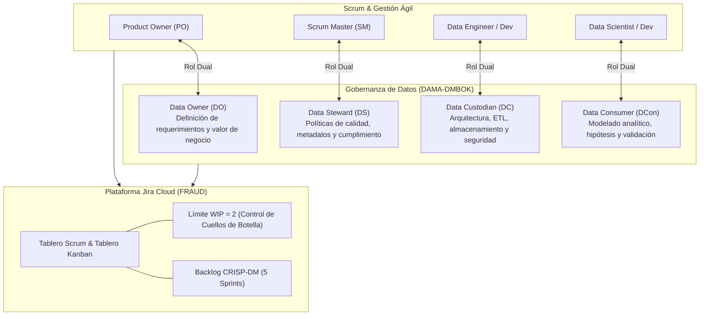
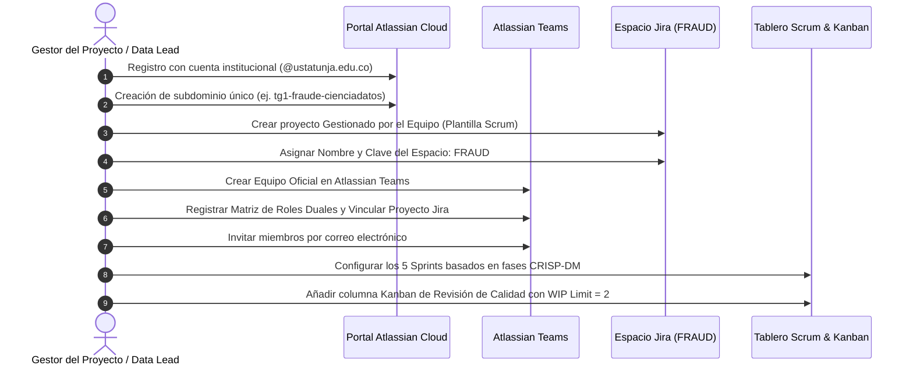
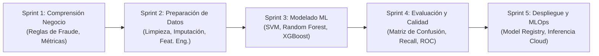
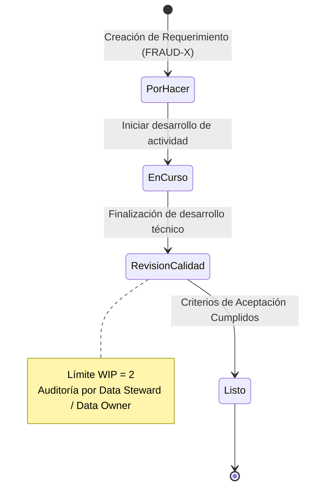

# Guía de Laboratorio: Jira Software — Gestión Ágil con Scrum y Kanban, y los Cuatro Roles Duales de Gobernanza

Esta guía técnica complementa el video tutorial oficial **[Creación de tablero en JIRA](https://www.youtube.com/watch?v=1EgdFLurvxk)** y el documento oficial en PDF [`guia_jira_software.pdf`](./guia_jira_software.pdf), detallando la implementación de **Jira Cloud** desde cero como plataforma de gestión ágil de proyectos y gobernanza de datos para el proyecto de investigación aplicada en **Detección Temprana de Fraude Transaccional en Canales Digitales**.

---

## 🏗️ 1. Arquitectura de Gobernanza Ágil (Scrum + DAMA-DMBOK)

En los proyectos de Ciencia de Datos y MLOps, los roles ágiles tradicionales de Scrum convergen con el marco de gobernanza **DAMA-DMBOK** para asegurar tanto la velocidad de entrega (*time-to-market*) como la calidad, trazabilidad y cumplimiento ético/legal de los activos de datos.

---

## 👥 2. Matriz de los Cuatro Roles Duales de Gobernanza

| Rol Scrum | Rol DAMA-DMBOK | Identificador en Jira | Responsabilidad en el Proyecto de Fraude |
|---|---|:---:|---|
| **Product Owner** | **Data Owner** | `PO-DataOwner` | Define los objetivos estratégicos de negocio, criterios de aceptación, KPIs de fraude y prioriza las historias del Backlog. |
| **Scrum Master** | **Data Steward** | `SM-DataSteward` | Facilita ceremonias ágiles, elimina impedimentos, garantiza estándares de calidad del dato, catálogo de metadatos y gobernanza ética. |
| **Data Engineer** | **Data Custodian** | `Dev-DataCustodian` | Responsable técnico de la ingesta de transacciones, pipelines ETL/ELT, almacenamiento seguro en Lakehouse y cumplimiento de políticas de acceso. |
| **Data Scientist** | **Data Consumer** | `Dev-DataConsumer` | Explora datos, entrena y regulariza modelos de Machine Learning (SVM, Random Forest), valida hipótesis y consume inferencias. |

---

## ⚙️ 3. Flujo de Configuración de Jira Cloud paso a paso

---

## 🏃 4. Estructura de Sprints Mapeados a CRISP-DM

El proyecto de Trabajo de Grado 1 organiza su ciclo de vida analítico en **5 Sprints** alineados con la metodología estándar de la industria **CRISP-DM**:

1. **Sprint 1 — Comprensión del Negocio y del Dato:** Definición del problema analítico, reglas heurísticas actuales y levantamiento de fuentes transaccionales.
2. **Sprint 2 — Preparación de Datos e Ingeniería de Características:** Limpieza de nulos, tratamiento de atípicos, codificación de variables categóricas y creación de ratios transaccionales.
3. **Sprint 3 — Modelado de Machine Learning:** Entrenamiento supervisado, barridos de hiperparámetros (SVM regularizado, ensambles) y seguimiento en MLflow.
4. **Sprint 4 — Evaluación de Modelos y Validación de Negocio:** Comparación de curvas ROC/PR, optimización de sensibilidad clínica (*Recall*) para minimizar falsos negativos.
5. **Sprint 5 — Despliegue, Monitoreo y Gobernanza MLOps:** Versionamiento en Model Registry, inferencia batch/streaming y auditoría de decisiones.

---

## 📊 5. Tablero Kanban con Límite de Trabajo en Curso (WIP Limit)

Para evitar la saturación del equipo y garantizar que ninguna tarea pase a producción sin revisión rigurosa:

- **Estados del Flujo de Trabajo:**
  1. `Por hacer` (*To Do*)
  2. `En curso` (*In Progress*)
  3. `Revisión de Calidad / Gobernanza` (*Quality Review*) — **WIP Limit = 2**
  4. `Listo` (*Done*)

> [!TIP]
> El límite **WIP = 2** en la columna de revisión evita cuellos de botella en la validación de hipótesis estadísticas y asegura que los modelos sean revisados por el Data Steward antes de ser promovidos al Model Registry.

---

## 📝 6. Ejemplo de Historia de Usuario con Rol Dual

- **Clave:** `FRAUD-1`
- **Título:** *Ingesta y perfilamiento exploratorio del dataset transaccional con detección de nulos.*
- **Descripción:**  
  *Como `Dev-DataConsumer`, quiero cargar y analizar la distribución de montos transaccionales para identificar patrones atípicos y valores faltantes.*
- **Etiquetas:** `Dev-DataConsumer`, `PO-DataOwner`, `Fase-EDA`, `Sprint-1`
- **Criterios de Aceptación:**
  1. Script ejecutable sin errores en Databricks.
  2. Gráficas de distribución de montos y tasa de nulos documentada.
  3. Aprobación del `SM-DataSteward` en la revisión de metadatos.

---

## 📚 Enlaces y Recursos

- **Video Tutorial en YouTube:** [Creación de tablero en JIRA (1EgdFLurvxk)](https://www.youtube.com/watch?v=1EgdFLurvxk)
- **Documento PDF Oficial:** [`guias/guia_jira_software.pdf`](./guia_jira_software.pdf)
- **Portal de Jira Cloud:** [Atlassian Jira Software](https://www.atlassian.com/es/software/jira)
- **Guía de Trabajo de Grado 1:** [`Trabajo de grado 1/README.md`](../README.md)
