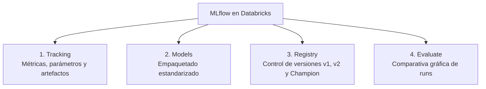
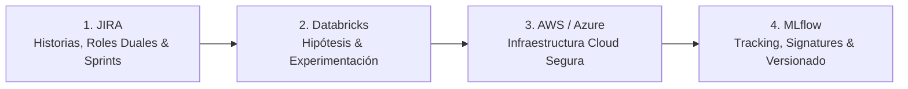

# Guía de Grabación 05: MLflow & Solución de Errores de Versionamiento

Esta guía técnica paso a paso está diseñada como guion para que grabes el video final de la serie sin tropiezos. Cada sección detalla **qué mostrar en pantalla**, **qué narrar en voz en off**, el **código reproducible** y la **solución exacta a los errores de versionamiento más temidos por los principiantes**.

---

## Ficha Técnica del Video
* **Título sugerido:** *"MLflow para Dummies: Tracking de Experimentos, Model Registry y Solución a Errores Clásicos de Versionamiento"*.
* **Audiencia:** Estudiantes de posgrado, desarrolladores y científicos de datos que necesitan asegurar el Nivel 1 de madurez MLOps (reproducibilidad y modelos versionados).
* **Duración estimada:** 22 a 26 minutos.
* **Prerrequisitos:** Cualquier Workspace de Databricks activo (Community Edition, AWS o Azure) con un clúster Databricks Runtime ML encendido.

---

## Bloque 1: Introducción a MLflow y sus Cuatro Componentes

* 🎬 **En pantalla:** Abre el navegador en tu Workspace de Databricks y muestra en pantalla la siguiente infografía o diapositiva:



* 🎙️ **Narración:** 
  > *"Hola a todos y bienvenidos al video final de nuestra serie. Hasta ahora entrenábamos modelos en notebooks, pero ¿cómo sabemos cuál fue el mejor hiperparámetro de hace tres semanas? ¿Cómo garantizamos que el modelo funcione igual en producción que en nuestro entorno de pruebas? Para eso existe MLflow, la plataforma estándar de MLOps. Lo mejor de todo es que en Databricks viene 100% preinstalado y configurado de forma nativa."*

---

## Bloque 2: Instrumentación de Experimentos con MLflow Tracking

### Paso 2.1: Crear el Notebook del Experimento
* 🎬 **En pantalla:** En tu Workspace de Databricks, crea un nuevo Notebook llamado `05_MLflow_Tracking_y_Versionamiento`. Asócialo al clúster activo.

### Paso 2.2: Tracking Automatizado y Manual
* 🎬 **En pantalla:** En la primera celda, escribe y ejecuta el código que registra múltiples modelos variando hiperparámetros:

```python
import mlflow
import mlflow.sklearn
from sklearn.datasets import load_wine
from sklearn.model_selection import train_test_split
from sklearn.ensemble import RandomForestClassifier
from sklearn.metrics import accuracy_score, f1_score

# 1. Carga de datos reales
wine = load_wine(as_frame=True)
X = wine.data
y = wine.target

X_train, X_test, y_train, y_test = train_test_split(X, y, test_size=0.25, random_state=42, stratify=y)

# 2. Definición formal del experimento en MLflow
mlflow.set_experiment("/Users/tu_usuario/Experimento_Clasificacion_Vinos")

# 3. Bucle de experimentación con registro explícito de parámetros y métricas
n_estimators_list = [5, 20, 50, 100]
max_depths = [2, 4, 8, None]

for n in n_estimators_list:
    for depth in max_depths:
        run_name = f"RF_trees_{n}_depth_{depth}"
        
        with mlflow.start_run(run_name=run_name):
            # Modelo
            model = RandomForestClassifier(n_estimators=n, max_depth=depth, random_state=42)
            model.fit(X_train, y_train)
            
            # Predicciones
            preds = model.predict(X_test)
            acc = accuracy_score(y_test, preds)
            f1 = f1_score(y_test, preds, average='weighted')
            
            # Registro en MLflow
            mlflow.log_param("n_estimators", n)
            mlflow.log_param("max_depth", depth if depth is not None else "None")
            mlflow.log_metric("accuracy", acc)
            mlflow.log_metric("f1_score", f1)
            
            # Guardar el modelo como artefacto
            mlflow.sklearn.log_model(model, artifact_path="modelo_random_forest")
            
            print(f"Run: {run_name} | Acc: {acc:.3f} | F1: {f1:.3f}")
```

* 🎙️ **Narración:** 
  > *"Observen el bloque `with mlflow.start_run()`. Con este sencillo contexto de Python, cada combinación de hiperparámetros queda grabada como una corrida (run) independiente. Registramos los parámetros con `log_param`, las métricas con `log_metric` y el modelo entrenado con `log_model`. Nada se pierde."*

---

## Bloque 3: Exploración y Comparación Gráfica en la UI de MLflow

### Paso 3.1: Abrir la barra lateral de experimentos
* 🎬 **En pantalla:** En la barra superior derecha del Notebook de Databricks, haz clic en el icono de matraz de laboratorio **"Experiment"** (Experimentos).
* 🎬 **En pantalla:** Verás desplegarse una barra lateral con la lista de todas las corridas (`RF_trees_5_depth_2`, etc.) con sus valores de Accuracy y F1.
* 🎬 **En pantalla:** Haz clic en el enlace superior: **"View experiment list"** o **"Open Experiment UI"** (Ver interfaz completa del experimento).
* 🎙️ **Narración:** 
  > *"Databricks nos muestra de inmediato la tabla de experimentos. Pero lo más potente es la visualización comparativa."*

### Paso 3.2: Comparativa visual de corridas (Scatter plot y Parallel Coordinates)
* 🎬 **En pantalla:** Marca la casilla superior para seleccionar todas las corridas (runs) $\rightarrow$ haz clic en el botón **"Compare"** (Comparar).
* 🎬 **En pantalla:** En la pestaña **Visualizations**:
  * Cambia el tipo de gráfico a **"Parallel Coordinates"** (Coordenadas paralelas).
  * Selecciona como ejes: `n_estimators`, `max_depth` y `f1_score`.
* 🎬 **En pantalla:** Pasa el cursor por las líneas que conectan los hiperparámetros con la métrica más alta (1.0).
* 🎙️ **Narración:** 
  > *"Con este gráfico de coordenadas paralelas, cualquier evaluador o líder de equipo puede ver en un segundo qué combinaciones de hiperparámetros maximizan la métrica. Vemos con total claridad que con 50 o 100 árboles y profundidad 4 u 8 alcanzamos el rendimiento óptimo."*

---

## Bloque 4: Registro y Promoción en el Model Registry

### Paso 4.1: Registrar la mejor versión (Model Registry)
* 🎬 **En pantalla:** Regresa a la tabla de corridas y haz clic en la corrida que tuvo el mejor F1-score.
* 🎬 **En pantalla:** Desplázate hacia abajo hasta la sección **Artifacts** y selecciona la carpeta `modelo_random_forest`.
* 🎬 **En pantalla:** En la esquina superior derecha del panel de artefactos, haz clic en el botón azul:
  👉 **"Register Model"** (Registrar modelo).
* 🎬 **En pantalla:** En el modal:
  * Selecciona **"Create New Model"** (Crear nuevo modelo).
  * **Model Name:** `Clasificador_Vinos_Produccion`.
* 🎬 **En pantalla:** Haz clic en **"Register"**. Se creará la `Version 1`.
* 🎙️ **Narración:** 
  > *"Acabamos de registrar formalmente nuestro modelo en el catálogo central de modelos (Model Registry). Esto crea un punto de control inmutable con su código binario, metadata y versión 1."*

### Paso 4.2: Asignación de Alias (Champion vs Challenger)
* 🎬 **En pantalla:** En el menú lateral izquierdo de Databricks, ve a **"Models"** $\rightarrow$ haz clic en `Clasificador_Vinos_Produccion`.
* 🎬 **En pantalla:** En la pestaña **Aliases**, asigna el alias `@champion` a la `Version 1`.
* 🎙️ **Narración:** 
  > *"En las versiones modernas de MLflow y Unity Catalog, ya no se usan las viejas etiquetas 'Staging/Production', sino 'Aliases' como Champion y Challenger. Asignamos el alias Champion a nuestra versión ganadora para que cualquier aplicación en producción consuma siempre el modelo actual."*

---

## Bloque 5: Solución a los 3 Grandes Errores de Versionamiento

> [!IMPORTANT]
> Esta sección es el corazón del video. La mayoría de tutoriales solo muestran cuando todo funciona; aquí provocaremos los 3 errores reales más comunes en proyectos de datos y mostraremos cómo corregirlos.

---

### ERROR 1: Incompatibilidad de Entorno y Dependencias (`conda.yaml` / `requirements.txt` Mismatch)

* 🎬 **En pantalla:** Muestra en el explorador de artefactos de MLflow los archivos que se crean automáticamente:
  * `MLmodel`
  * `conda.yaml`
  * `requirements.txt`
* 🎙️ **Narración:** 
  > *"¿Qué ocurre si entrenas un modelo en Databricks con Scikit-learn 1.5 y luego intentas cargarlo en un servidor local o API con Scikit-learn 1.2? Saltará un error de deserialización (`ModuleNotFoundError` o `InconsistentVersionWarning`) y el sistema colapsará."*

#### La Causa:
Si no fijas explícitamente las dependencias, MLflow toma el entorno global que puede cambiar con cada actualización del clúster.

#### La Solución Paso a Paso:
* 🎬 **En pantalla:** En una nueva celda de tu Notebook, muestra cómo guardar el modelo declarando exactamente sus requerimientos reproducibles con `pip_requirements`:

```python
# SOLUCIÓN ERROR 1: Empaquetado estricto de dependencias
import sklearn

exact_requirements = [
    f"scikit-learn=={sklearn.__version__}",
    "pandas>=2.0.0",
    "numpy>=1.24.0"
]

with mlflow.start_run(run_name="Modelo_Versionamiento_Robusto"):
    model = RandomForestClassifier(n_estimators=50, max_depth=4, random_state=42)
    model.fit(X_train, y_train)
    
    # Registramos el modelo especificando explícitamente las versiones
    mlflow.sklearn.log_model(
        sk_model=model,
        artifact_path="modelo_reproducible",
        pip_requirements=exact_requirements
    )

print("¡Modelo empaquetado con dependencias blindadas!")
```

* 🎙️ **Narración:** 
  > *"Al usar `pip_requirements=exact_requirements`, MLflow sella el archivo `requirements.txt`. Cuando Docker, Kubernetes o cualquier servicio web vaya a desplegar este modelo, instalará exactamente esas versiones garantizando reproducibilidad al 100%."*

---

### ERROR 2: Error de Esquema y Tipos de Datos (Model Signature Mismatch)

* 🎬 **En pantalla:** Escribe una celda de simulación del error:

```python
# SIMULACIÓN DEL ERROR: Enviar datos con columnas faltantes o tipos cambiados
loaded_model = mlflow.sklearn.load_model("runs:/[ID_DE_RUN]/modelo_random_forest")
# Si el usuario envía datos con nombres diferentes o sin una columna:
datos_erroneos = X_test.drop(columns=['alcohol'])  # Falta una columna
try:
    loaded_model.predict(datos_erroneos)
except Exception as e:
    print(f"ERROR PRODUCIDO EN PRODUCCIÓN:\n{e}")
```

* 🎬 **En pantalla:** Muestra el error en la consola: `ValueError: The feature names should match those that were passed during fit`.
* 🎙️ **Narración:** 
  > *"Este es el error número uno en pases a producción: el modelo espera 13 columnas y le envían 12, o le envían un texto donde esperaba un número decimal. Si no definimos una firma (Signature), el error ocurre tarde, en plena inferencia."*

#### La Solución Paso a Paso: Inferir y Guardar la Firma (`ModelSignature` e `input_example`)
* 🎬 **En pantalla:** Pega y ejecuta el código con la solución definitiva:

```python
# SOLUCIÓN ERROR 2: Inferencia de Firma y Ejemplo de Entrada
from mlflow.models import infer_signature

with mlflow.start_run(run_name="Modelo_Con_Firma_Validada"):
    model = RandomForestClassifier(n_estimators=50, max_depth=4, random_state=42)
    model.fit(X_train, y_train)
    
    # 1. Obtenemos las predicciones para generar la firma completa
    predictions = model.predict(X_train)
    
    # 2. Inferencia estricta del esquema (Inputs y Outputs con tipos exactos)
    signature = infer_signature(X_train, predictions)
    
    # 3. Ejemplo representativo de entrada (primeras 3 filas)
    input_example = X_train.iloc[:3]
    
    # 4. Guardamos con firma y ejemplo
    mlflow.sklearn.log_model(
        sk_model=model,
        artifact_path="modelo_con_firma",
        signature=signature,
        input_example=input_example
    )

print("Esquema registrado:")
print(signature)
```

* 🎬 **En pantalla:** Abre el artefacto en la interfaz de MLflow y muestra cómo ahora aparece una tabla visual detallando el **Input Schema** y **Output Schema** con nombres de columnas y tipos de datos (`double`, `long`, etc.).
* 🎙️ **Narración:** 
  > *"Miren qué elegancia: ahora MLflow valida automáticamente los datos de entrada antes de tocar el modelo. Si alguien envía una columna equivocada o con tipo de dato incompatible, MLflow rechaza la petición con un mensaje de validación claro en lugar de corromper la inferencia."*

---

### ERROR 3: Sobreescritura Accidental de Modelos y Pérdida de Trazabilidad

* 🎙️ **Narración:** 
  > *"¿Qué sucede si un compañero del equipo reentrena el modelo con otros datos y le asigna el mismo nombre o sobreescribe los archivos? Se pierde la trazabilidad científica requerida en la rúbrica de grado."*

#### La Solución Paso a Paso:
* 🎬 **En pantalla:** Muestra en el Model Registry cómo MLflow protege contra la sobreescritura:
  1. Cada registro sucesivo con el mismo nombre crea automáticamente una nueva versión incremental (`v2`, `v3`, `v4`).
  2. Ninguna versión anterior se elimina ni se sobreescribe.
  3. Para promover una nueva versión a producción sin romper clientes existentes, solo movemos el puntero del alias `@champion`:

```python
# SOLUCIÓN ERROR 3: Promoción segura con Alias en código o UI
from mlflow import MlflowClient

client = MlflowClient()

# Asignamos el alias @challenger a la versión 2 para pruebas paralelas
client.set_registered_model_alias(
    name="Clasificador_Vinos_Produccion",
    alias="challenger",
    version="2"
)

# Cuando la versión 2 supera las pruebas, la promovemos a @champion
client.set_registered_model_alias(
    name="Clasificador_Vinos_Produccion",
    alias="champion",
    version="2"
)

print("¡Promoción de versión realizada con éxito y sin sobreescritura!")
```

---

## Bloque 6: Integración del Ecosistema Completo (Cierre de la Serie)

* 🎬 **En pantalla:** Muestra el diagrama de cierre que une toda la serie:



* 🎙️ **Narración final sugerida:**
  > *"Y con esto completamos nuestra serie integral de 5 tutoriales para proyectos de Ciencia de Datos y MLOps. Aprendimos a gobernar el equipo en Jira con roles duales y sprints, a experimentar en Databricks Community, a desplegar en la nube corporativa con AWS y Azure controlando los costos, y finalmente a gobernar y versionar nuestros modelos con MLflow resolviendo los errores más comunes de la industria. Tienen todos los guiones, códigos y plantillas en los enlaces de la descripción. ¡Muchos éxitos en su sustentación de Trabajo de Grado y nos vemos en una próxima serie!"*
