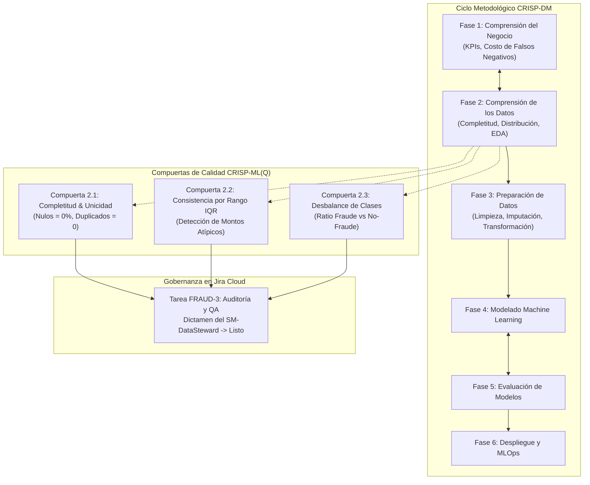
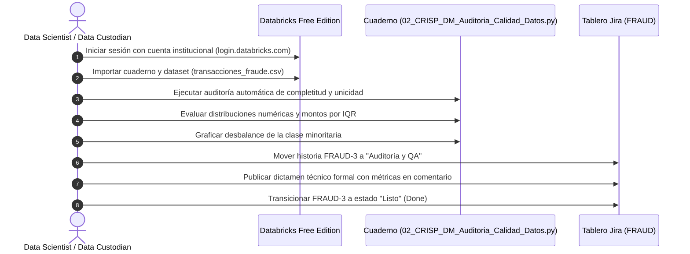

# Guía de Laboratorio: Databricks y Metodología CRISP-DM — Fases 1 a 3 y Compuertas de Calidad CRISP-ML(Q)

Esta guía técnica complementa el video tutorial oficial **[Databricks CRISP DM](https://youtu.be/X1JtylnPmsA)** y el documento oficial en PDF [`guia_crispdm_databricks.pdf`](./guia_crispdm_databricks.pdf), detallando la ejecución práctica de las tres primeras fases de la metodología **CRISP-DM** (*Cross-Industry Standard Process for Data Mining*) extendidas con las compuertas de aseguramiento de calidad del estándar **CRISP-ML(Q)** sobre un conjunto de **4.060 transacciones bancarias reales** para el proyecto de detección temprana de fraude en Jira (`FRAUD-3`).

---

## 🔄 1. Marco Metodológico: CRISP-DM y Extensión CRISP-ML(Q)

---

## 📋 2. Las Tres Compuertas de Calidad de Datos

Antes de avanzar a la fase de modelado predictivo, los datos deben superar tres compuertas formales de auditoría:

| Compuerta | Dimensión Evaluada | Métrica / Criterio de Aceptación | Resultado en el Dataset de Fraude (4.060 reg.) |
|---|---|---|:---:|
| **Compuerta 2.1** | **Completitud y Unicidad** | Cero valores nulos (`NaN`) en campos clave y cero registros duplicados por ID de transacción. | ✅ **100% Completitud** (0 nulos, 0 duplicados) |
| **Compuerta 2.2** | **Consistencia de Rango (IQR)** | Montos transaccionales analizados mediante Rango Intercuartílico ($Q_1 - 1.5 \times IQR$ a $Q_3 + 1.5 \times IQR$). | ⚠️ **Atípicos legítimos** identificados en transacciones sospechosas |
| **Compuerta 2.3** | **Desbalance de la Variable Objetivo** | Cuantificación de la asimetría en la etiqueta de fraude (`is_fraud` / `fraude`). | ⚖️ **Severamente Desbalanceado** (~1.8% fraude, requiere técnicas de remuestreo) |

---

## ⚙️ 3. Procedimiento en Databricks Free Edition

### Pasos Clave en el Laboratorio:
1. **Acceso a Databricks:** Ingresar a `https://login.databricks.com` seleccionando *Personal Account* (Free Edition).
2. **Carga de Archivos:** En el espacio personal del Workspace, importar:
   - Cuaderno: `02_CRISP_DM_Auditoria_Calidad_Datos.py`
   - Conjunto de datos: `transacciones_fraude.csv` (4.060 registros transaccionales).
3. **Ejecución de la Auditoría:** Ejecutar todas las celdas para calcular completitud, IQR y ratio de fraude.
4. **Registro en Jira:** En el espacio del proyecto ágil `FRAUD`, mover la tarea `FRAUD-3` de *En curso* a *Auditoría y QA*, registrar el dictamen en un comentario y cerrarla en *Listo*.

---

## 📝 4. Dictamen Formal de Calidad Registrado en Jira

> **Dictamen de Auditoría — Compuerta CRISP-ML(Q) Fase 2:**  
> - **Dataset:** `transacciones_fraude.csv` (4.060 filas, 10 columnas).  
> - **Completitud:** 100% de datos íntegros sin valores faltantes.  
> - **Unicidad:** 100% de identificadores únicos verificados.  
> - **Distribución:** Rango IQR validado; los montos elevados corresponden a patrones anómalos sujetos a modelado.  
> - **Recomendación para Fase 3 y 4:** Aplicar técnicas de balanceo (SMOTE / class_weight) en el entrenamiento y priorizar métricas de **Recall / PR-AUC** por encima de Accuracy.  
> - **Decisión:** **APROBADO PARA TRANSICIÓN A MODELADO.**

---

## 📚 Enlaces y Recursos

- **Video Tutorial en YouTube:** [Databricks CRISP DM (X1JtylnPmsA)](https://youtu.be/X1JtylnPmsA)
- **Documento PDF Oficial:** [`guias/guia_crispdm_databricks.pdf`](./guia_crispdm_databricks.pdf)
- **Plataforma Databricks:** [Databricks Login](https://login.databricks.com)
- **Guía Anterior (Jira Software & Roles Duales):** [`guia_05_jira_software.md`](./guia_05_jira_software.md)

