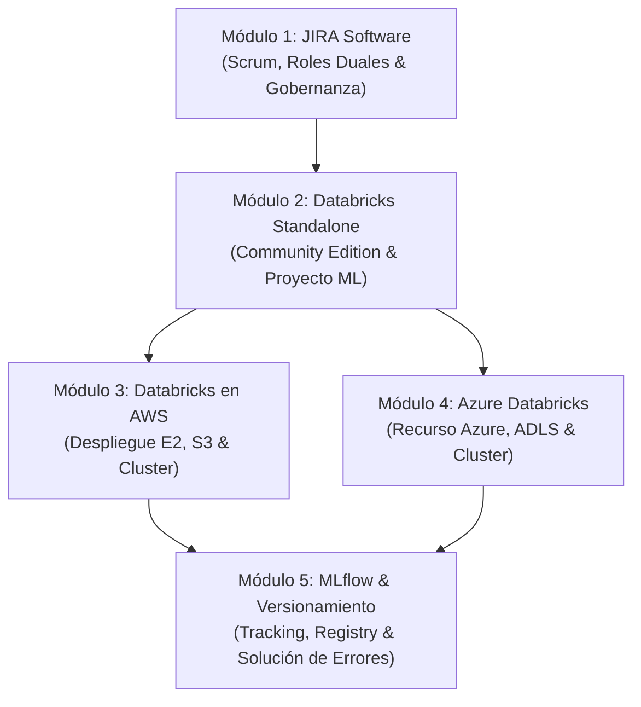

# Plan de Acción: Serie de Video Tutoriales de Ciencia de Datos y MLOps

Este plan organiza la serie en **5 módulos prácticos**, adaptados a las directrices académicas y profesionales de proyectos de Ciencia de Datos (integrando **Scrum + Gobernanza de Datos + CRISP-DM + MLOps**).

---

## 1. Estructura Didáctica de Cada Guía ("Para Dummies")
Cada guía funciona como guion técnico para la grabación del video e incluye:
1. **Ficha Técnica:** Duración estimada, objetivo pedagógico y prerrequisitos (cuentas, accesos, invitaciones).
2. **Guion de Grabación de Pantalla (Paso a Paso):**
   * *Acción en pantalla:* Clics exactos, menús, campos a diligenciar y qué mostrar.
   * *Narración / Voz en off:* Explicación clara sin tecnicismos innecesarios.
3. **Bloque de Advertencias y Buenas Prácticas:** Gestión de accesos, prevención de cobros en la nube y configuración de roles.
4. **Plantillas y Código Listos para Usar:** Scripts comentados, tablas de roles e historias de usuario listas para copiar/pegar.

---

## 2. Mapa General de la Serie

---

## 3. Desglose Detallado Herramienta por Herramienta

### Módulo 1: JIRA Software — Gestión Ágil, Asignación de Roles Duales y Gobernanza
* **Objetivo:** Configurar un entorno de trabajo colaborativo en Jira Software alineado con la metodología de proyectos de Ciencia de Datos (Scrum + Gobernanza).
* **Paso a paso de grabación:**
  1. **Creación y Configuración del Proyecto:**
     * Registro en Atlassian Cloud.
     * Selección de la plantilla oficial **Scrum** (gestión por sprints).
     * Configuración del proyecto y vinculación/invitación formal al docente como observador/revisor.
  2. **Configuración y Asignación de Roles Duales (Scrum + Gobernanza de Datos):**
     * *Esquema para Equipos de 4 integrantes:*
       1. **Product Owner & Data Owner:** Responsable del valor del producto, visión de negocio, autorización y propiedad de fuentes de datos.
       2. **Scrum Master & Data Steward:** Facilitador del flujo ágil, calidad, catalogación y definiciones de metadatos/diccionario de datos.
       3. **Equipo de Desarrollo (Ing. de Datos) & Data Custodian:** Almacenamiento, arquitectura técnica, tuberías de datos, seguridad y accesos.
       4. **Equipo de Desarrollo (Analítica y Estadística) & Data Consumer:** Análisis exploratorio, modelado predictivo, experimentación y consumo final de datos.
     * *Esquema para Equipos de 3 integrantes:*
       1. **Product Owner + Data Owner + Data Consumer.**
       2. **Scrum Master + Data Steward.**
       3. **Equipo de Desarrollo + Data Custodian.**
     * *Asignación práctica en Jira:* Creación de Project Roles o Custom Fields/Etiquetas por rol para etiquetar y filtrar qué rol es responsable de cada ticket.
  3. **Planificación de los 5 Sprints Semanales:**
     * Creación del Backlog priorizado (mínimo 10 historias de usuario con Criterios de Aceptación y Definición de Terminado - DoD).
     * Distribución de tareas para los 5 Sprints (Sprint 1 a 5: desde la constitución del equipo, auditoría de datos, diseño de arquitectura hasta la definición del MVP).
  4. **Trazabilidad Individual, Revisiones y Retrospectivas:**
     * Cómo asignar tickets para que los aportes individuales de cada rol sean medibles y auditables para la evaluación.
     * Registro de la **Sprint Review** y **Sprint Retrospective** en Jira (con decisiones de mejora explícitas).

---

### Módulo 2: Databricks Directo (Standalone / Community Edition)
* **Objetivo:** Introducir la plataforma pura de Databricks para experimentación sin costos de infraestructura.
* **Paso a paso de grabación:**
  * Registro paso a paso en **Databricks Community Edition** (100% gratuito).
  * Tour de la interfaz: Workspace, Repos/Git Folders, Compute, Data/Catalog y Notebooks.
  * Creación y arranque del Compute básico (micro clúster).
  * Desarrollo de un Notebook de ML con formulación de hipótesis:
    * Formulación de hipótesis nula ($H_0$) y alternativa ($H_1$).
    * Carga de dataset clásico real (ej. Wine Quality o California Housing, sin datos sintéticos).
    * Entrenamiento con algoritmo clásico de Scikit-Learn (Decision Tree / Random Forest).
    * Modificación interactiva de hiperparámetros (ej. `max_depth`) y análisis de impacto en métricas (Accuracy/RMSE, overfitting vs underfitting).

---

### Módulo 3: Databricks en Amazon Web Services (AWS)
* **Objetivo:** Desplegar y operar Databricks a nivel empresarial sobre infraestructura AWS.
* **Paso a paso de grabación:**
  * Preparación de AWS: Usuario IAM con políticas de privilegios mínimos y revisión de Free Tier.
  * Registro en Databricks E2 y vinculación con AWS (Cross-account IAM Role y Bucket S3 de storage raíz).
  * Creación del Workspace corporativo.
  * Creación de Compute de bajo costo (Single-Node con Auto-Termination configurado en 20 minutos).
  * Importación del Notebook de Ciencia de Datos y ejecución del experimento de ML.
  * Procedimiento de parada y apagado para evitar sobrecostos en AWS.

---

### Módulo 4: Azure Databricks (Microsoft Azure)
* **Objetivo:** Desplegar Databricks como servicio nativo de Microsoft Azure.
* **Paso a paso de grabación:**
  * Configuración de la suscripción de Azure.
  * Creación del recurso gestionado *Azure Databricks* desde Azure Portal (Pricing tier: Standard vs Premium).
  * Acceso mediante Single Sign-On institucional (Microsoft Entra ID).
  * Configuración del clúster de cómputo en Azure con terminación automática.
  * Carga del proyecto de ML, validación de hipótesis y visualización de métricas.
  * Diferencias y ventajas comparativas frente al entorno AWS.

---

### Módulo 5: MLflow & Manejo de Errores de Versionamiento
* **Objetivo:** Garantizar la reproducibilidad, el gobierno y el ciclo de vida del modelo de Machine Learning (MLOps Nivel 1).
* **Paso a paso de grabación:**
  * Uso de MLflow Tracking nativo en Databricks.
  * Instrumentación: `mlflow.autolog()` vs registro manual (`log_param`, `log_metric`, `log_model`).
  * Comparación visual de ejecuciones (Runs) y curvas de hiperparámetros vs métricas.
  * Registro del modelo en **Model Registry** (versionamiento v1, v2 y asignación de tags/alias Champion/Challenger).
  * **Solución práctica a errores críticos de versionamiento:**
    * *Error 1: Incompatibilidad de entorno / librerías:* Diagnóstico y corrección en `conda.yaml` y `requirements.txt`.
    * *Error 2: Discrepancia de esquemas (Signature Mismatch):* Cómo evitar caídas en inferencia definiendo `ModelSignature` con `input_example`.
    * *Error 3: Conflictos de artefactos y sobreescritura de modelos.*

---

## 4. Próximo Paso Inmediato
Comenzar con la redacción de la **Guía 1: JIRA Software (Scrum, Roles Duales y 5 Sprints)** en formato listo para grabación.
